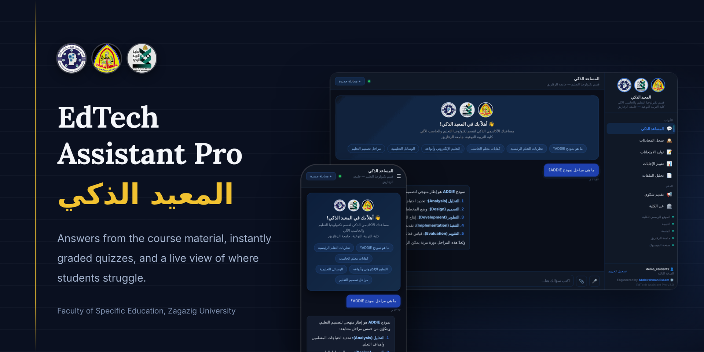
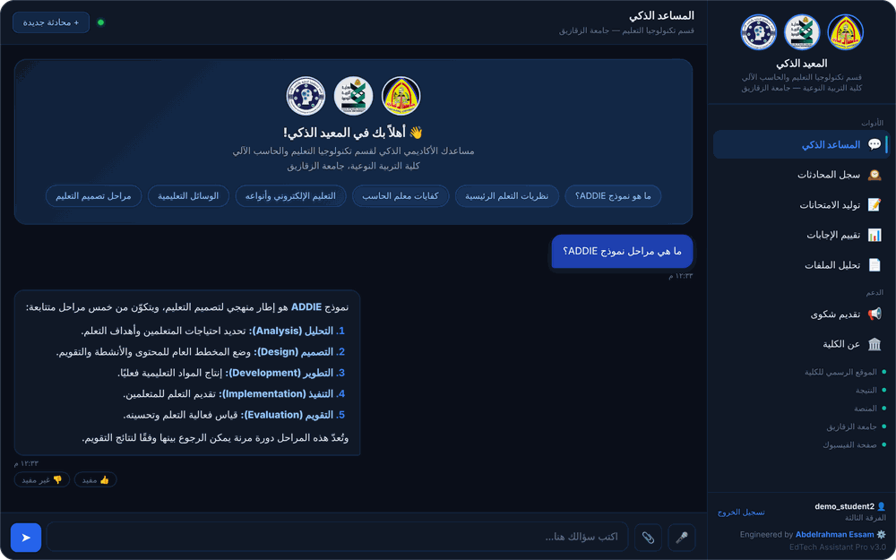
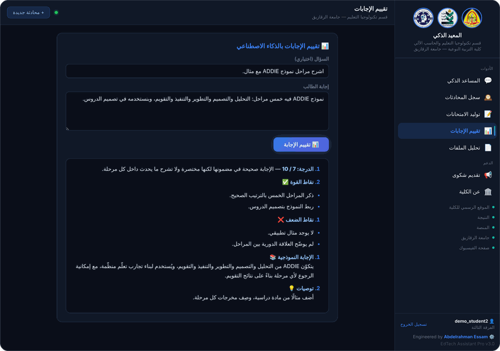
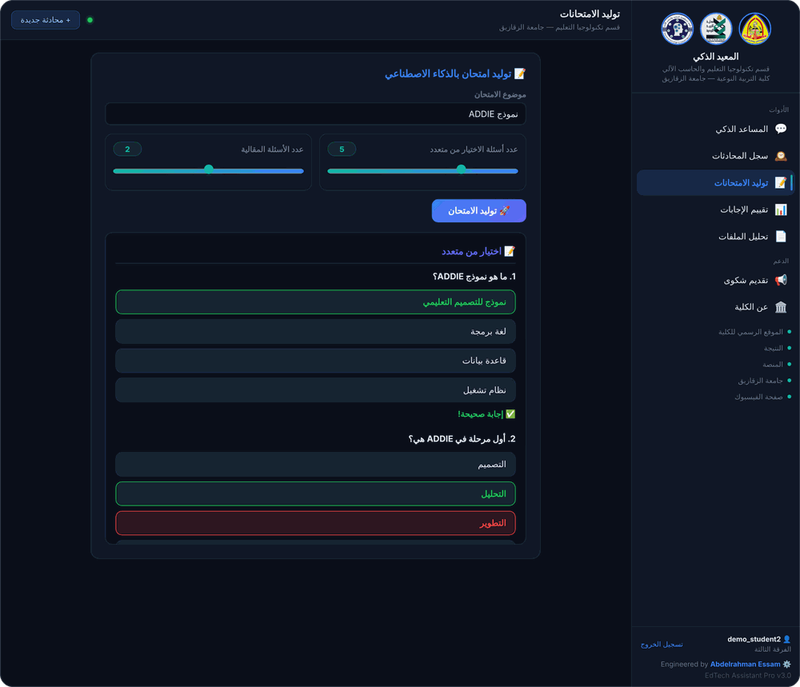
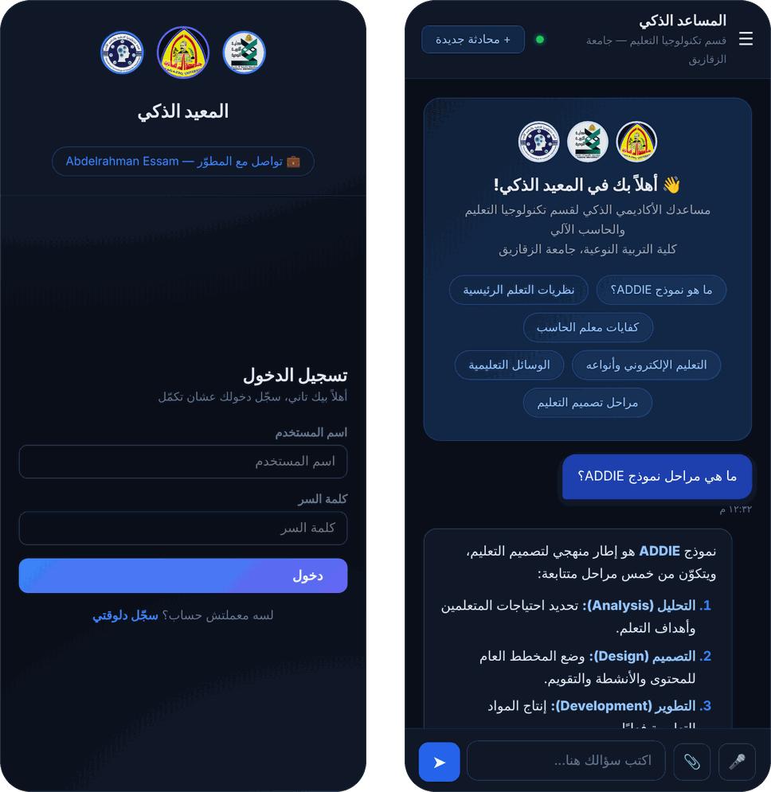
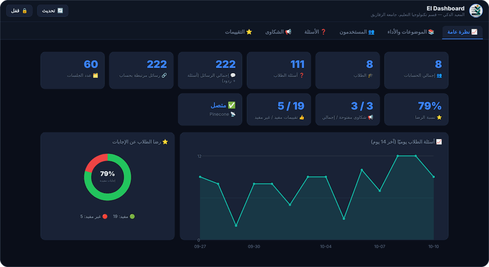
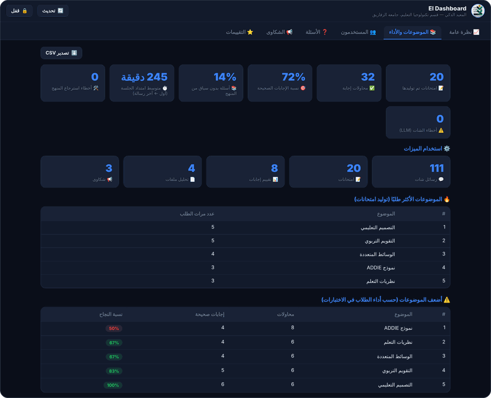
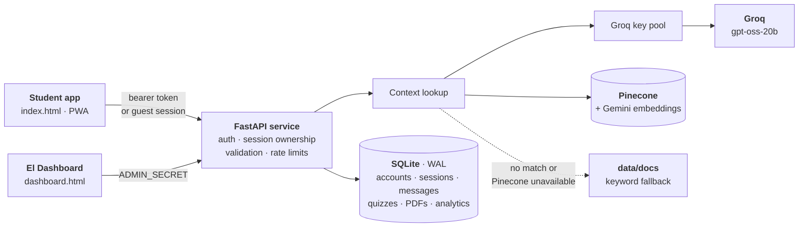

<h1 align="center">
  
</h1>

<div align="center">

[](https://adam1230-edtech-assistant-pro.hf.space/)


[Features](#features) · [Screenshots](#screenshots) · [Quick start](#quick-start) · [Configuration](#configuration) · [Architecture](#architecture) · [API](#api-reference) · [Testing](#testing)

</div>

**EdTech Assistant Pro** (*المعيد الذكي*, "the Smart TA") is an Arabic-first academic assistant for 3rd-year students of the Educational Technology & Computer Science department, Faculty of Specific Education, Zagazig University. It answers curriculum questions from the department's own material, generates exams and interactive quizzes, grades free-text answers and summarizes lecture PDFs, all in a streaming chat interface designed right-to-left. A password-protected analytics page, **El Dashboard**, shows staff what students ask and where they struggle.

It is one FastAPI service plus one self-contained, installable (PWA) frontend, shipped as a single Docker image. This deployment serves the **3rd year only**: one application grade (`APP_GRADE`), one Pinecone index and one namespace, so students never choose a grade.

<div dir="rtl" align="right">

**المعيد الذكي** مساعد أكاديمي بالذكاء الاصطناعي، واجهته عربية بالكامل، لطلبة الفرقة الثالثة بقسم تكنولوجيا التعليم والحاسب الآلي — كلية التربية النوعية، جامعة الزقازيق. يجيب عن أسئلة المنهج اعتمادًا على مواد القسم، ويولّد امتحانات واختبارات تفاعلية يصحّحها الخادم تلقائيًا، ويقيّم الإجابات المكتوبة، ويلخّص ملفات المحاضرات (PDF). وتتيح لوحة التحليلات **El Dashboard** للمشرفين متابعة أكثر الأسئلة تكرارًا والموضوعات التي يتعثّر فيها الطلبة.

</div>

## Features

| Feature | What it does |
|---|---|
| 💬 **Streaming chat** | Server-sent events from `/chat/stream`. Markdown is rendered in the browser and sanitized with DOMPurify. |
| 📚 **Grounded answers (RAG)** | Pinecone vector search with Gemini embeddings, a keyword fallback over `data/docs`, or the session's uploaded PDF. Every answer records how its context was found. |
| 📝 **Exams and interactive quizzes** | Text exams, or clickable multiple-choice quizzes with instant feedback. Scoring happens on the server; the client never decides what is correct. |
| ✍️ **Answer grading** | Free-text answers are graded by the LLM and streamed back with feedback. |
| 📄 **PDF assistant** | Upload a lecture PDF, then summarize it or ask questions about it. Size, pages and extracted text are bounded, and each document is stored per session with a TTL. |
| 🔐 **Accounts and history** | bcrypt passwords, expiring hashed bearer tokens and permanent per-user conversation history. Guests can chat too, and a guest session can never be claimed by a logged-in user. |
| 📊 **El Dashboard** | A standalone page at `/dashboard`, gated by `ADMIN_SECRET`: usage, weak topics, content gaps, complaints and feedback. |
| 🔑 **Resilient LLM access** | A pool of up to five Groq keys. Keys rotate only on errors where a different key can actually help. |
| 📱 **PWA** | Installable. The service worker caches only the app shell and static assets. |

## Screenshots

> Captured from the running app with a seeded demo database and scripted stand-ins for the language model and the vector store, so no real student data or live model output appears. Fonts differ slightly from the deployed app.

### Student app

<table>
  <tr>
    <td width="50%" valign="top">
      
      <br><sub><b>Chat.</b> Streaming answers grounded in the course material, rendered as sanitized Markdown.</sub>
    </td>
    <td width="50%" valign="top">
      
      <br><sub><b>Answer grading.</b> A score, strengths, weaknesses, a model answer and recommendations.</sub>
    </td>
  </tr>
</table>

<table>
  <tr>
    <td width="50%" valign="top">
      
      <br><sub><b>Quizzes.</b> Clickable multiple choice with instant feedback. The server checks every answer.</sub>
    </td>
    <td width="50%" valign="top">
      
      <br><sub><b>On a phone.</b> Right-to-left layout and an installable PWA.</sub>
    </td>
  </tr>
</table>

### El Dashboard



<sub><b>Overview.</b> Accounts, student questions, satisfaction, complaints and a 14-day trend. Everything is read live from the database.</sub>



<sub><b>Topics and performance.</b> Most requested exam topics, weakest topics by quiz accuracy, content gaps and feature usage.</sub>

## Quick start

You need Python 3.11 and a [Groq](https://console.groq.com/) API key. Pinecone and Google (Gemini) keys are optional; without them the app answers from the keyword fallback in `data/docs`.

```bash
# 1. Install
python -m venv .venv
source .venv/bin/activate        # Windows PowerShell: .venv\Scripts\Activate.ps1
pip install -r requirements.txt

# 2. Configure
cp .env.example .env
#    ...open .env now and set ADMIN_SECRET and GROQ_API_KEY...
set -a; . ./.env; set +a         # the app reads environment variables; it does not load .env itself

# 3. Run
uvicorn app:app --port 7860
```

Open <http://localhost:7860/> for the student app and <http://localhost:7860/dashboard> for El Dashboard (sign in with `ADMIN_SECRET`).

<details>
<summary><b>Windows PowerShell</b></summary>

```powershell
python -m venv .venv
.venv\Scripts\Activate.ps1
pip install -r requirements.txt

$env:ADMIN_SECRET = "<a long random string>"
$env:GROQ_API_KEY = "<your Groq key>"
uvicorn app:app --port 7860
```

</details>

Generate an admin secret with `python -c "import secrets; print(secrets.token_urlsafe(24))"`. The app refuses to start without one.

### Docker

```bash
docker build -t edtech-assistant-pro .
docker run --rm -p 7860:7860 --env-file .env edtech-assistant-pro
```

Docker reads the same `.env` through `--env-file`, so there is no `source` step. The image runs as a non-root user and listens on port 7860. The SQLite database lives inside the container unless a writable `/data` is mounted, so treat this as a smoke test; Hugging Face Persistent Storage provides `/data` in production.

### Hugging Face Spaces

1. Create a Space with the **Docker** SDK and push this repository to it. The front matter at the top of this README (`sdk: docker`, `app_port: 7860`) configures the Space.
2. Under **Settings → Variables and secrets**, add `ADMIN_SECRET`, `GROQ_API_KEY`, and optionally `PINECONE_API_KEY` and `GOOGLE_API_KEY` as secrets. Set `PINECONE_INDEX` and `PINECONE_NAMESPACE` only if they differ from the defaults.
3. Enable **Persistent Storage** so `/data` exists. Without it the database is recreated on every restart and accounts are lost.

Images and logos are tracked with Git LFS (see `.gitattributes`) because Hugging Face does not accept plain binary files in a push. Run `git lfs install` once per machine before you clone or commit, or the images are checked out as small pointer files.

## Configuration

All configuration is environment variables; [`.env.example`](.env.example) lists every one with its default. **`ADMIN_SECRET` and at least one Groq key are required.**

| Variable | Default | Purpose |
|---|---|---|
| `ADMIN_SECRET` | **none, required** | Password for `/dashboard` and `/dash/*`. The app **refuses to start** if it is empty or equals the retired default `admin_2025`. |
| `GROQ_API_KEY`, `GROQ_API_KEY_2` … `GROQ_API_KEY_5` | none | Up to five Groq credentials; empty ones are skipped. See [Groq key pool](#how-it-works). |
| `GOOGLE_API_KEY` / `GEMINI_API_KEY` | none | Gemini embeddings for vector retrieval. |
| `PINECONE_API_KEY` | none | Pinecone access. |
| `PINECONE_INDEX` | `edtech-db` | Pinecone index to query. |
| `PINECONE_NAMESPACE` | `""` | Namespace to query (empty is the default namespace). |
| `FALLBACK_DOCS_PATH` | `data/docs` | Keyword-fallback knowledge file. |
| `APP_GRADE` | `3` | The single grade this deployment serves; every student account resolves to it. |
| `ALLOWED_ORIGINS` | empty | Comma-separated CORS origins. Empty means same-origin only; `*` is rejected at startup. |
| `SESSION_LIFETIME_HOURS` | `720` | Login token lifetime. |
| `MIN_PASSWORD_LEN` | `8` | Minimum password length. The maximum is 72 bytes, bcrypt's limit. |
| `LOGIN_MAX_ATTEMPTS` / `LOGIN_WINDOW_SECONDS` | `5` / `300` | Failed-login limit per username. |
| `ADMIN_MAX_ATTEMPTS` / `ADMIN_WINDOW_SECONDS` | `10` / `300` | Wrong-secret attempts allowed per client per window (a wider global cap also applies). |
| `RATE_LIMIT_MAX_KEYS` | `5000` | Cap on tracked rate-limit keys, which bounds memory. |
| `MAX_PDF_MB` / `MAX_PDF_PAGES` / `MAX_PDF_TEXT_CHARS` | `10` / `60` / `8000` | PDF upload limits. |
| `DOCUMENT_TTL_HOURS` | `24` | How long an uploaded PDF's text is kept. |
| `LOG_LEVEL` / `LOG_FILE` | `INFO` / none | Logging level and an optional log file path. Logs always go to stdout and stderr. |

## Architecture



- **No transaction is held open while waiting for Groq or Pinecone.** Every database operation is a short, self-contained transaction on its own connection (WAL, `foreign_keys=ON`, 30 s busy timeout). Streaming endpoints save the user message, release the database, stream from Groq, then save the assistant message and the analytics event.
- **Database location:** `/data/app_data.db` when `/data` exists and is writable (Hugging Face Persistent Storage), otherwise `./app_data.db`.
- **Logs** go to stdout and stderr, and to a file only if `LOG_FILE` is set. Passwords, tokens, API keys and the admin secret are never logged.

| Layer | Technology |
|---|---|
| Backend | Python 3.11, FastAPI 0.111, Uvicorn, SQLite (WAL) |
| LLM | Groq, model `openai/gpt-oss-20b` |
| Retrieval | Pinecone with Gemini embeddings (`models/gemini-embedding-001`) |
| PDF | PyMuPDF |
| Auth | bcrypt, SHA-256-hashed bearer tokens |
| Frontend | One HTML file, vanilla JS, DOMPurify and marked (CDN) |
| Deploy | Docker (non-root user, port 7860), Hugging Face Spaces |

## How it works

<details>
<summary><b>Retrieval and status</b></summary>

&nbsp;

Context for a question comes from the session's uploaded PDF if there is one. Otherwise the app queries Pinecone (top 5 matches, similarity ≥ 0.55) and falls back to a keyword search over `data/docs` when Pinecone is absent, has no good match, or fails. The LLM still answers when no context is found; the app is not PDF-only.

Every chat and exam event records a `retrieval_status`:

| Status | Meaning |
|---|---|
| `vector` | Pinecone returned matches above the similarity threshold. |
| `fallback` | Context came from the keyword file (Pinecone absent, empty or failed). |
| `empty` | Retrieval worked and found nothing relevant: a **real content gap**. |
| `error` | Pinecone failed *and* the fallback found nothing: an **infrastructure** problem, not a content gap. |
| `document` | The session's uploaded PDF was used as context. |
| `unavailable` | The account's grade is not served by this deployment. |

A `vector_error` flag is also stored when Pinecone failed but the fallback rescued the answer. The Dashboard's *content-gap rate* counts only `empty`; errors are reported separately. `GET /kb-status` returns `configured`, `connected`, `fallback_available` and `ready_grades`.

</details>

<details>
<summary><b>Groq key pool</b></summary>

&nbsp;

Up to five credentials. For each request the keys are tried in a random order, **each at most once**:

- `401`, `403`, `404`, `5xx` and connection errors: try the next key.
- `429` (rate limit): **not** rotated. The limit is respected and the request fails. Multiple keys give operational resilience against a revoked or misconfigured key; they do not multiply the provider's quota.
- `400`-class errors (a problem with the request itself): fail immediately.
- Streaming rotates only while *opening* the stream, before any token is sent.
- Keys are never logged, stored or returned to a client. Clients see a generic message, never provider error text.

</details>

<details>
<summary><b>Authentication and session ownership</b></summary>

&nbsp;

- **Tokens:** a random 256-bit bearer token is returned once to the client. The database stores only its SHA-256 hash plus `expires_at`. Logout deletes it, and expired or corrupt tokens behave exactly like invalid ones.
- **Passwords:** bcrypt, `MIN_PASSWORD_LEN` to 72 bytes. Usernames are 3 to 64 characters (trimmed). Concurrent duplicate registrations resolve to one `200` and the rest `409`.
- **Login rate limit:** `LOGIN_MAX_ATTEMPTS` failures per username per window returns `429`. The tracker is process-local (no Redis) and size-bounded.
- **Admin:** `ADMIN_SECRET` (constant-time comparison, rate-limited) protects `/dash/*`. There is no other admin interface.
- **Session ownership:** one helper, `get_authorized_session`, guards every endpoint that touches a `session_id`:

| Caller ↓ / Session → | owned by user A | anonymous | unknown id |
|---|---|---|---|
| user A | ✅ | ❌ 403 | write: created and owned by A · read: 404 |
| another user B | ❌ 403 | ❌ 403 | same as above |
| guest holding the id | ❌ 403 | ✅ | write: created anonymous · read: 404 |

A request with no `session_id` gets a fresh `secrets.token_urlsafe` id. Read-only requests (such as `GET /history/{id}`) never create sessions. Security does not depend on id secrecy; ownership is checked every time.

</details>

<details>
<summary><b>Quizzes</b></summary>

&nbsp;

`POST /exam` returns an interactive quiz with a `quiz_id`, and the answer key is stored **server-side** (`quizzes.questions_json`). The browser still receives `correct_index` so it can color options instantly, but `POST /quiz/answer` accepts only `quiz_id`, `question_index` and `chosen_index`. Correctness is computed from the stored key, and any extra fields are ignored.

A quiz can be answered only by its owner (an anonymous quiz only by the anonymous holder, never by a logged-in user who merely knows the id), and each question only once: a duplicate, even a simultaneous one, gets a deterministic `409`.

</details>

<details>
<summary><b>PDF pipeline</b></summary>

&nbsp;

The upload is streamed to a temporary file and aborted as soon as `MAX_PDF_MB` is exceeded. The page count is checked before extraction (`MAX_PDF_PAGES`), and extraction stops at `MAX_PDF_TEXT_CHARS`. PyMuPDF validates the real file structure (the extension alone is not trusted), and malformed, encrypted or non-PDF files get a clear `422`. The temporary file is always deleted.

Extracted text, owner, filename (metadata only, never a path), size and upload time live in the `documents` table with a TTL (`DOCUMENT_TTL_HOURS`), and expired rows are purged on upload. Nothing depends on a per-process in-memory cache.

</details>

<details>
<summary><b>Analytics and El Dashboard</b></summary>

&nbsp;

Every operation writes **one** analytics event (`chat`, `exam`, `grade`, `pdf`, `complaint`, …) with `status` (`ok`, `error` or `cancelled`), `stream` (true or false), `session`, safe metadata and, for chat and exam, `retrieval_status`. Streaming chat is logged as `chat` with `stream: true`, never as a separate feature. A failed stream stores no assistant message and one `error` event; a stream the client abandons stores one `cancelled` event.

`/dashboard` (password: `ADMIN_SECRET`) reads live from the database on every refresh:

| Tab | Shows | Source |
|---|---|---|
| Overview | Accounts, students, **student questions**, **total messages (questions + replies)**, sessions, satisfaction, complaints, feedback, a 14-day trend of questions per day, a feedback donut | `users`, `messages`, `sessions`, `feedback`, `complaints` |
| Topics & performance | Exams generated, quiz attempts, overall accuracy, content-gap rate, retrieval errors, LLM chat errors, feature usage, most-requested exam topics, weak topics (≥ 3 attempts), most-missed questions, average **session span** (first to last message, *not* active time) | `analytics`, `quiz_answers` (server-scored) |
| Users | Per-user questions and last activity | `users`, `messages` |
| Questions | Most frequent questions (near-literal grouping) | `messages` |
| Complaints / Feedback | Full lists, with the submitter resolved through the session | `complaints`, `feedback`, `messages` |

Feedback `good` and `bad` are counted explicitly. Empty data shows `0` or `—`, never an invented value. CSV export happens in the browser and is protected against spreadsheet formula injection. Charts are inline SVG, so no external chart library is loaded.

`quiz_answers` rows written before server-side scoring was introduced cannot be told apart from later ones.

</details>

<details>
<summary><b>Database and migrations</b></summary>

&nbsp;

SQLite, versioned with `PRAGMA user_version` (current schema version: **2**). Startup runs one deterministic, idempotent migration inside a single transaction:

1. configure pragmas
2. create base tables (no indexes)
3. add any missing columns (`PRAGMA table_info`)
4. migrate data
5. create indexes **only after** their columns exist
6. validate the schema
7. bump `user_version`
8. commit

Legacy databases are upgraded in place, never reset:

- `messages` without `user_id` get the column added.
- Plaintext auth tokens are replaced by their SHA-256 hash (the token already held by the browser keeps working), and a missing `expires_at` is back-filled from `created_at`.
- `sessions` is back-filled from historical messages. A session with a logged-in user's messages is owned by that user, and a purely anonymous session stays anonymous. Ownership is never invented.
- Student accounts are normalized to `APP_GRADE`; other roles (such as `professor`) are untouched.

Tables: `users`, `auth_sessions`, `sessions`, `messages`, `analytics`, `quizzes`, `quiz_attempts`, `quiz_answers`, `documents`, `complaints`, `feedback`.

</details>

<details>
<summary><b>PWA and service worker</b></summary>

&nbsp;

`static/sw.js` uses an **allowlist**: only the app shell (`/`) and `/static/*` are cached. Every other request (`/auth`, `/history`, `/conversations`, `/chat`, `/exam`, `/quiz`, `/grade`, `/summary`, `/upload-pdf`, `/feedback`, `/complaint`, `/dash*`, `/dashboard`, the status endpoints and any endpoint added later) is not intercepted at all, so no private response can enter Cache Storage. Failed and opaque responses are never cached, and older cache versions are deleted on activation.

</details>

## API reference

| Method | Path | Notes |
|---|---|---|
| `POST` | `/auth/register`, `/auth/login` | Return `{token, username, role, grade}`. |
| `POST` | `/auth/logout` | Bearer token required. |
| `GET` | `/auth/me` | Bearer token required. |
| `POST` | `/chat`, `/chat/stream` | `{message, session_id?}`. The stream sends `token` events, then `done`. |
| `POST` | `/exam` | Interactive quiz (`quiz_id`; question types `mcq`, `essay`, `practical`) or a text fallback. |
| `POST` | `/exam/stream` | Text exam, streamed. |
| `POST` | `/quiz/answer` | `{quiz_id, question_index, chosen_index}` returns `{ok, is_correct}`. `404` unknown quiz, `403` not yours, `400` bad index, `409` already answered. |
| `POST` | `/grade`, `/grade/stream` | `{answer, question?, session_id?}`. |
| `POST` | `/upload-pdf?session_id=…` | Multipart `file`. `413` too big or too long, `422` unreadable. |
| `POST` | `/summary`, `/summary/stream` | `{session_id}`; needs an uploaded PDF in that session. |
| `POST` | `/complaint`, `/feedback` | `feedback.rating` is `good` or `bad`. |
| `GET` | `/conversations`, `/history/{session_id}` | Owner only. |
| `GET` | `/kb-status`, `/health` | Public status. |
| `GET` | `/` | Serves the student app (PWA shell). |
| `GET` | `/dashboard` | Serves El Dashboard. |
| `POST` | `/dash/summary`, `/dash/topics`, `/dash/questions`, `/dash/complaints`, `/dash/feedback` | Body `{secret}`. |

Request bounds, all enforced server-side: message ≤ 4000 characters · exam topic ≤ 200 · `num_mcq` 1–20 · `num_essay` 0–10 · graded answer ≤ 8000 · complaint ≤ 3000 · feedback question ≤ 2000 and answer ≤ 20000 · session id `^[A-Za-z0-9_.:-]{1,128}$`. Violations return `422`.

## Ingesting course material

`scripts/upload_to_pinecone.py` loads PDFs into the production index. It runs on your machine, not on the Space. It uses the same embedding model as the app, stable vector ids (file name plus chunk number) so a re-run updates instead of duplicating, and a `--dry-run` that lists files and chunk counts without calling any API. Before writing, it checks that the embedding dimension matches the index, and it asks for confirmation if the namespace already holds vectors (`--yes` skips the prompt).

```bash
pip install -r scripts/requirements.txt
export PINECONE_API_KEY=... GOOGLE_API_KEY=...

python scripts/upload_to_pinecone.py --folder ./materials/grade3_pdfs --dry-run
python scripts/upload_to_pinecone.py --folder ./materials/grade3_pdfs
```

`--index-name` and `--namespace` default to the values the app reads (`PINECONE_INDEX`, `PINECONE_NAMESPACE`). If they differ from the app's, the vectors land where the app does not look.

## Project structure

```text
.
├── app.py                    # FastAPI application: routes, auth, sessions, RAG, analytics, migrations
├── frontend/
│   ├── index.html            # student app (chat, exams, grading, PDF, history, complaints)
│   └── dashboard.html        # El Dashboard (standalone admin analytics page)
├── static/
│   ├── auth.js, auth.css     # sign-in and register screen
│   ├── sw.js                 # service worker (allowlist caching)
│   ├── manifest.json         # PWA manifest
│   └── *.png, *.jpg          # university, faculty and department logos
├── data/
│   └── docs                  # keyword-fallback knowledge (plain text, blank-line separated paragraphs)
├── scripts/
│   ├── upload_to_pinecone.py # ingest PDFs into the production index (run locally)
│   └── requirements.txt
├── tests/
│   ├── test_backend.py       # offline integration suite
│   ├── sw_test.js            # service-worker behaviour test (Node)
│   └── pdf_fixtures.py       # generates valid PDF bytes for the tests
├── docs/                     # README banner and screenshots
├── .env.example              # every environment variable, documented
├── Dockerfile, .dockerignore, .gitattributes, .gitignore
├── requirements.txt
├── LICENSE
└── README.md
```

## Testing

```bash
pip install -r requirements.txt
python tests/test_backend.py     # integration suite; exits with code 1 on any failure
node tests/sw_test.js            # service-worker behaviour (Node, no dependencies)
```

The suite is fully offline: Groq, Pinecone and Gemini are replaced by test doubles, and no live service is contacted. It runs on an isolated temporary copy of the project, so it never touches your `app_data.db`. It covers:

- migrations: a fresh database, a legacy schema without `messages.user_id`, legacy plaintext tokens, and a copy of a local `app_data.db` when one exists (the original is hash-checked and never mutated)
- SQLite concurrency, including a probe showing that no write lock is held while waiting on the LLM
- auth, rate limits and admin access
- the full session-ownership matrix and creation races
- quiz forgery and concurrent duplicate submissions
- the PDF pipeline: valid PDF bytes, malformed files, size, page and text limits, temp-file cleanup and TTL
- Groq key rotation rules
- stream lifecycle accounting (ok, error, cancelled)
- retrieval statuses and content-gap math
- every Dashboard metric checked against the database
- input validation and the ingestion script (with fake `pinecone` and `google.genai` modules)
- a scan showing that no token, password, admin secret or API key reaches the logs or the database

Not covered by automated tests: live Groq, Pinecone and Gemini calls, real-browser rendering, and load or capacity. **No capacity figures are claimed**, and five Groq credentials give resilience, not five times the provider's rate limit.

## Security notes

- There is no default admin secret, and startup fails without one. The comparison is constant-time and rate-limited.
- Tokens are stored as SHA-256 hashes with an expiry, passwords are bcrypt-hashed, and nothing sensitive is logged.
- Ownership is enforced strictly on every session endpoint, and quiz scoring never trusts the client.
- CORS is closed by default (same-origin), and wildcard origins are rejected.
- AI and Markdown output is sanitized with DOMPurify, user-controlled strings are escaped before they reach `innerHTML` (quotes included), and CSV export neutralizes formula injection.
- The service worker never caches private API responses.
- Rate limiting is process-local. If the app is ever run with several workers, each keeps its own counters.

## Official links

- [🏛️ Faculty of Specific Education](https://www.zu.edu.eg/Contents/Section/25)
- [🎓 Zagazig University](https://www.zu.edu.eg/)
- [📊 Student results portal (النتيجة)](https://studentactivities.zu.edu.eg/Students/Registration/ed_login.aspx)
- [🖥️ Student platform (المنصة)](<https://sestudent.eps.zu.edu.eg/(X(1)S(fyo2xlkz0mizgi5oinxw1zfa))/Views/StudentViews/StudentLogin>)
- [👥 Faculty Facebook page](https://www.facebook.com/share/g/1DKEacDTCW/)

## Credits

Engineered and developed by **[Abdelrahman Essam](https://www.linkedin.com/in/hbdelrahman-essam)**, Department of Educational Technology & Computer Science, Faculty of Specific Education, Zagazig University.

## License

Released under the [MIT License](LICENSE). The names and logos of Zagazig University, the Faculty of Specific Education and the department that appear in `static/` and in the screenshots belong to their respective institutions and are not covered by the MIT License.
